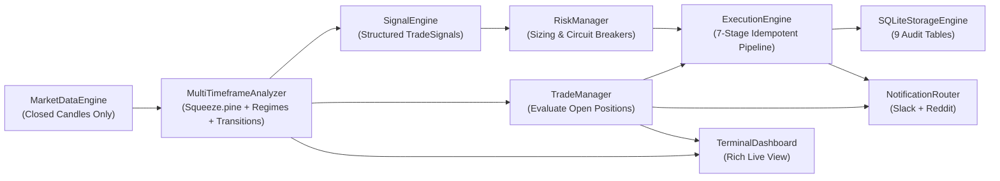
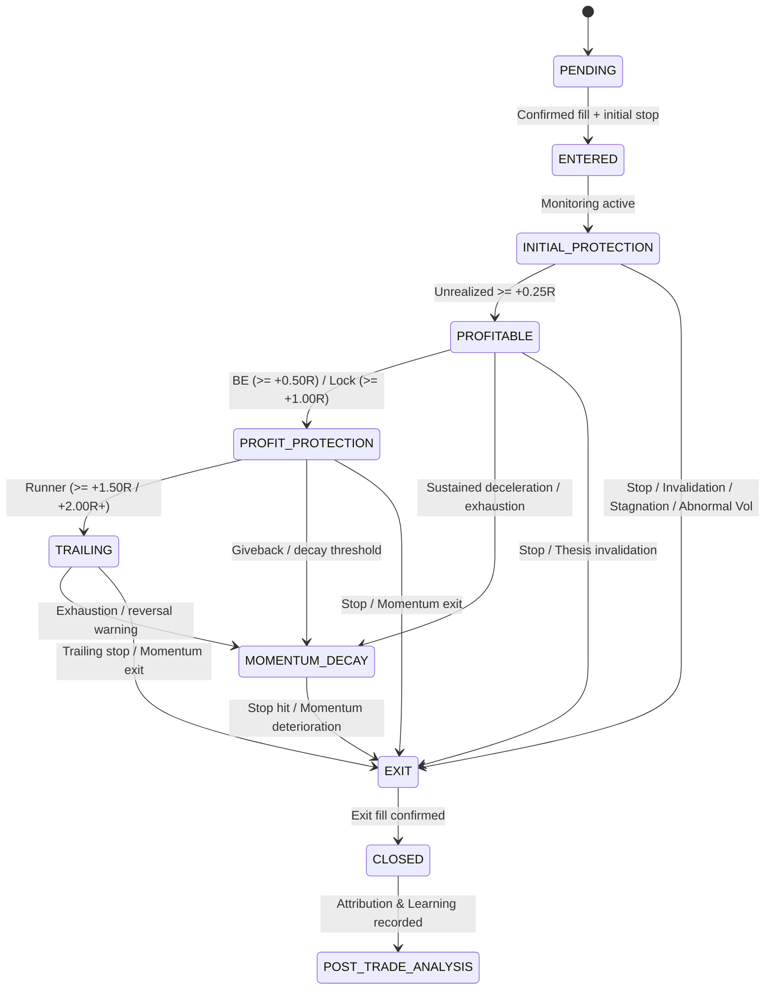

# Deriv Squeeze Intelligent Trade Management Engine — Architecture & Pine Analysis

## Phase 1 — Line-by-Line Analysis of `Squeeze.pine`

`Squeeze.pine` (Pine Script v1/v2 by LazyBear, 40 lines) is the sole analytical market-state sensor for this engine. Every mathematical detail is preserved verbatim in `bot/indicators/squeeze.py`:

| Pine Lines | Statement | Mathematical Definition & Parity Detail |
|---|---|---|
| 1–5 | `study(shorttitle="Squeezer", title="Squeeze Momentum Indicator ", overlay=false)` | Non-overlay oscillator rendered around zero. |
| 7–12 | `length=20`, `mult=2.0`, `lengthKC=20`, `multKC=1.5`, `useTrueRange=true` | Configurable inputs. |
| 15–19 | `source = close`; `basis = sma(source, length)`; `dev = multKC * stdev(source, length)`; `upperBB = basis + dev`; `lowerBB = basis - dev` | **Critical LazyBear Quirk:** Line 17 uses `multKC` (`1.5`), NOT `mult` (`2.0`), and Pine's `stdev` uses population standard deviation (`ddof=0`). Both `lazybear_mult_parity=True` (default) and `ddof=0` are preserved. |
| 22–26 | `ma = sma(source, lengthKC)`; `range = useTrueRange ? tr : (high - low)`; `rangema = sma(range, lengthKC)`; `upperKC = ma + rangema * multKC`; `lowerKC = ma - rangema * multKC` | Pine's bare `tr` equals `ta.tr(false)`: on bar `0` (when `close[1]` does not exist), `tr` is `NaN`, so `rangema` and KC bands first become valid on bar index `lengthKC` (bar 21 for `lengthKC=20`). Setting `tr_handle_na=True` switches to `high - low` on bar `0`. |
| 28–30 | `sqzOn = (lowerBB > lowerKC) and (upperBB < upperKC)`; `sqzOff = (lowerBB < lowerKC) and (upperBB > upperKC)`; `noSqz = (sqzOn == false) and (sqzOff == false)` | `SQUEEZE_ON` (BB strictly inside KC), `SQUEEZE_OFF` (BB strictly outside KC), `NO_SQUEEZE` (overlapping/equal bands). All three are `False` during band warmup. |
| 32–33 | `val = linreg(source - avg(avg(highest(high, lengthKC), lowest(low, lengthKC)), sma(close, lengthKC)), lengthKC, 0)` | Let `donchian_mid = 0.5 * (max(high, lengthKC) + min(low, lengthKC))`, `baseline = 0.5 * (donchian_mid + sma(close, lengthKC))`, and `delta = source - baseline`. `linreg(delta, L, 0)` evaluates the OLS regression line over the trailing `L` deltas at `x = L - 1` via exact closed-form weights: `w[i] = 1/L + ((x_mean - 0) / (L*(L^2 - 1)/12)) * (i - x_mean)` where `x_mean = (L - 1) / 2`. First valid `val` occurs at bar index `2 * lengthKC - 2` (`38`, i.e. bar 39 for `lengthKC=20`). |
| 35–37 | `bcolor = iff(val > 0, iff(val > nz(val[1]), lime, green), iff(val < nz(val[1]), red, maroon))` | `nz(val[1])` substitutes `0.0` when `val[1]` is `NaN` (the first valid momentum bar). Positive rising = `lime`, positive falling/flat = `green`, negative falling = `red`, negative rising/flat = `maroon`. |
| 38–40 | `scolor = noSqz ? blue : sqzOn ? black : gray` | Cross color at zero: `blue` (`NO_SQUEEZE`), `black` (`SQUEEZE_ON`), `gray` (`SQUEEZE_OFF`). |

### Scale-Free Momentum Normalization (Downstream Sensor Enrichment)

Raw `val` is denominated in instrument price units (`R_10` vs `R_100` vs `frxXAUUSD` differ by orders of magnitude). Without altering `val` itself, `bot/indicators/squeeze.py` attaches:
- `normalized_momentum = val / max(range_ma, 1e-12)`
- `momentum_strength = min(1.0, abs(tanh(normalized_momentum / 1.5)))`
- `bb_kc_ratio = (upper_bb - lower_bb) / max(upper_kc - lower_kc, 1e-12)`

---

## Phase 2 — System Architecture

### Strict Dependency Layering

```text
core (enums, models, events)
  ▲
config (settings.py, settings.yaml, symbols.yaml)
  ▲
indicators (squeeze.py)
  ▲
strategy (market_state.py, signals.py)
  ▲
management (stop_manager, profit_manager, exit_engine, trade_manager) + risk (risk_manager)
  ▲
deriv (client, market_data, account, execution) + storage (database) + analytics + notifications + dashboard + backtest
  ▲
app (lifecycle, logging_setup, main)
```

### Data & Control Flow



### Trade Lifecycle State Machine



### Pre-Execution Safety Pipeline

`TradeSignal` → `Risk Check` → `Exposure Check` → `Duplicate / Idempotency Check (in-memory + SQLite)` → `Contract Validation` → `Broker Execution (Paper or Double-Locked Live)` → `Execution Confirmation` → `Position Registration`.

### Alert Priority Routing

| Priority | Example Events | Slack | Reddit |
|---|---|---|---|
| `INFO` | Market state transitions, routine scans | Filtered by default | Filtered by default |
| `NOTICE` | Opportunity detected, trade opened, profit lock, trade closed | Sent (respects cooldown) | Educational sanitized post |
| `WARNING` | Momentum deterioration, drawdown approaching cap | Sent | Aggregate recap only |
| `CRITICAL` | Daily loss / consecutive loss limit reached | Immediate (bypasses cooldown) | Optional alert |
| `EMERGENCY` | API inconsistency, execution uncertainty, hard invalidation | Immediate (bypasses cooldown) | Never exposes credentials |
